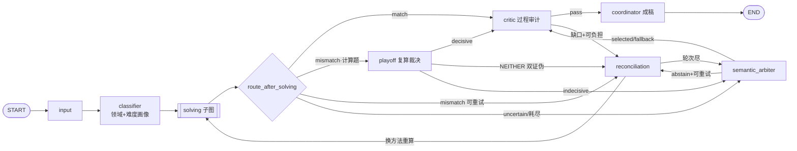
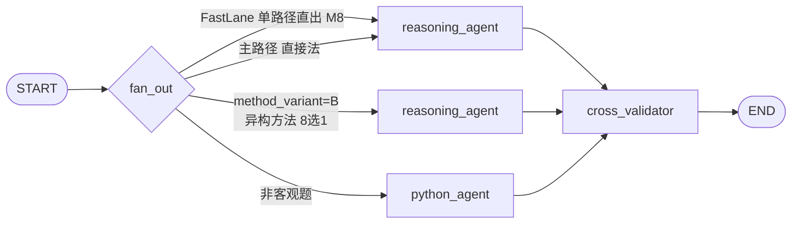

# 起源数智 — 多径推理与过程审计数学智能体

> 2026 挑战杯人工智能赛道 · XH-202627「基于 Intern-S1 的数学智能体设计与推理创新」初赛作品
> 在一个公开 LangGraph 图架构参考基线之上，深度重构与扩展的原创版本；
> 依上游 AGPLv3 许可开源衍生，保留全部原始版权声明。

本项目是一个面向数学题自动求解的多智能体系统，以 LangGraph 为编排框架。相对基线架构，
起源数智围绕「**正确答案率**」这一唯一客观判分维度，针对上游方案在评委报告中暴露的
失分形态，新增五大机制：**异构双方法推理、过程审计智能体、确定性复算季后赛、难度感知
动态预算、模结构确定性守护**，并对符号等价判定与代码执行沙箱做了工程加固。

当前交付版本 **V2.5.8 回退修复版（2026-08-24）**：V2.5.7 官方 53.57 分（慢 API
批次，含 6 题 invalid）后，回到 V2.5 (61.61) 纯净路线——**移除全部 V2.5.7 机制**
（PV 过程验证器/仲裁 PV/复积分守卫），保留全部 bug 修复（截断治理/漏括号/
matcher 守卫/pacer/form_align re 笔误/幽灵配置键）与合规收敛（client 只读）。
详见根目录 DELIVERY.md 与 docs/提交前自检清单.md。

竞赛接口保持约定：评测侧导入 `user_agent.py` 的 `ReasoningAgent`，平台以其官方 client 构造，
调用 `solve(problem, metadata)` 取得 `final_response` 与 `trace`。

---

## 1. 为什么这样升级：基线失分点 → 机制对照

既有图架构基线的残余失分，来自其架构无法覆盖的四类形态：

| 基线失分形态（评委报告实录） | 根因 | 起源数智 机制 |
|---|---|---|
| F₂ 六值按整数相加得 3（应模 2 得 1） | 提示词"注意模结构"无强制力 | **模结构守护**：语境检出 + 提示强制条款 + 代码静态核查三重防线 |
| 多问漏答（三值报一）、三空答零空仍 0.78 置信放行 | 契约检查靠手写正则，必然漏 | **过程审计 Critic**：LLM 契约审计 + 计算抽核，缺口转定向修复 |
| 输出被自家程序反驳的答案（枚举得公式却输出 "4"） | 仲裁只能"选"不能"算" | **确定性复算 Playoff**：候选代回原题复算裁决 |
| 同一思路重复同一错误（重跑无信息量） | 单样本推理的系统性强偏差 | **异构第二推理路径**：构造/不变量/反向/生成函数强制换方法 |
| 简单题与奥赛题同吃 1200s 软预算 | 无全局预算观（6h÷并发3≈9.6min/题） | **难度感知软预算**：easy/medium/hard 三档，分类顺带输出 |
| `4π(32-a⁵)/5` 与等价 LaTeX 判不了落仲裁 | simplify 无超时、异名符号不判 | **matcher 加固**：限时代简、符号对齐映射、≤4 维采样 |
| 客观题单采样定生死 | 无独立复核 | **低置信复核投票**（仅空位覆盖不足时触发） |
| 执行代码可 import 任意库/读环境变量 | 沙箱只限时不限能 | **执行器加固**：危险能力静态拦截 + POSIX 资源限额 |

## 2. 系统架构

### 2.1 主图拓扑



与基线的拓扑差异：**所有答案进 coordinator 前必经 Critic 审计门**；计算题冲突
**先进 Playoff 再决定重算或仲裁**——重算从"第一反应"降级为"复算无效后的手段"。

> V2.1/V2.3 的增强（M7 证明深加工 → M12 逻辑自检 → M13 覆盖检查 → M14 难题兜底）
> 全部收敛在 coordinator 节点内部，不改变主图拓扑——成稿前做"结构补强 + 逻辑审查 +
> 覆盖核对 + 放弃兜底"四道后处理。

### 2.2 Solving 子图（多径扇出）



第二推理路径（`method_variant="B"`）通过 `DIVERSE_METHOD_HINT` 强制切换方法论，
从八类独立方法中选一（V2.3 M11 由 4 类扩充）：构造枚举 / 不变量极端原理 /
反向归谬 / 生成函数递推 / 变量代换 / 逼近极限 / 对偶互补 / 特例反推，
与主路径形成方法论独立的双证据。触发纪律（控成本）：

- **FastLane（V2.1 M8）**：L1 客观题且分类高置信 → 单路径直出，跳过 B 路径与
  Python（省时间给难题）；
- **首轮**：仅高风险领域（离散数学、非基础及进阶课程、微分几何、测度积分——
  评测集占比最高且单样本错误率最高的四类）并行扇出；
- **重算轮**：一律追加（此时已知首路径失败，多样性正是缺的东西）；
- 客观题、时间 fast path、`enable_diverse_reasoning=False` 时不发。

三路比对规则：主路径与 Python 不一致但**第二路径与 Python 一致**时直接采纳第二路径
（异构方法的独立双证据，强于任何单路径）。

### 2.3 过程审计智能体（Critic）

定稿前的质量门，两级审计：

1. **契约完整性**：确定性契约（`answer_contract`，零成本）与 LLM 审计
   （prefill JSON，~15s）合并判定，保守方向——任一方报缺即缺。
   覆盖：多问项逐项、枚举全列+总数、区间双端点、检验结论句、极值+取到构造、
   "最小常数"类的上界论证+下界构造对。
2. **关键计算抽核**：LLM 挑 1-3 个中间计算独立复算，`calc_error` 是强于"缺项"
   的重算信号。

路由：pass → coordinator；缺口且可负担 → 调解阶段**定向修复**（缺口清单随提示下发，
修复轮次独立计数封顶 1 次，杜绝审计-重算死循环）；否则带缺口标记进 coordinator——
缺口清单会显性追加进成稿提示，完整说明成为最后一次补齐机会。

### 2.4 确定性复算季后赛（Playoff）

两路候选冲突时的第三选择（基线只有"整轮重跑"与"仲裁二选一"）：
**不解原题，只做候选代回核验**——方程回代看残差、极值实测目标值并查约束、
计数缩小规模暴力枚举对照、存在性实际搜索构造。

- `A`/`B`/`BOTH`：锁定被独立计算支持的候选 → Critic；
- `NEITHER`（双证伪，强信号）→ 带证伪信息回调解，换方法重算；
- `INCONCLUSIVE`/故障 → 回退既有的重试/仲裁通道，不放大损失。

成本 ≈ 一次 prefill 代码生成（~60-150s）+ 一次沙箱执行（≤60s），
显著低于整轮 solving 重跑（~500-900s）。每题至多进入一次（`playoff_trace` 防循环）。

### 2.5 难度感知动态预算

全局约束（2026-08 判分规则）：112 题、平台并发 3、智能体总运行 6h 封顶，
超出的未答题不计分 ⇒ 平均每题仅 ~9.6 分钟。分类 prefill 顺带输出难度画像
（边际成本≈0），`TimeBudget.apply_difficulty_profile()` 据此收紧**软预算**：

| 画像 | 软预算 | 含义 |
|---|---:|---|
| easy（含全部客观题） | 480s | 快速路径，停止购买可选 LLM 阶段 |
| medium | 840s | 保留一次重试与仲裁 |
| hard | 1200s | 全预算 |

安全边界：软预算只决定可选阶段购买力；`remaining_hard`（平台 1200s 硬限）永不下调，
进行中的调用不被截断，reserve 配额通道（压缩重试/仲裁/应急直答）照常可用。
简单题绝不会出现"被截断交白卷"。

### 2.6 其他加固

- **matcher**：`simplify` 8s 限时（超时降级采样，不再卡死关键路径）；自由符号
  异名时按基数相等尝试重命名映射（n≤3 全置换，n=4 排序直映）再采样；采样维度上限 4。
- **客观题复核投票**：空位覆盖不足等低置信形态触发一次独立短采样比对，
  一致提置信 0.9，分歧保留更完整一方并留证。
- **执行器**：静态拦截危险导入/调用（subprocess、socket、os.system、写模式 open 等；
  放行 `sys.setrecursionlimit` 等竞赛常用操作）；POSIX 下 RLIMIT_AS 2GB + RLIMIT_CPU
  + 独立进程组。
- **trace 可审计**：diverse_reasoning / deterministic_playoff / process_audit /
  objective_revote / modular_guard 各阶段证据全部入 trace，供 judger 综合判定。

## 3. 目录结构（相对基线的新增）

```text
├── nodes/
│   ├── critic_node.py            # 【新】过程审计智能体：契约完整性 + 计算抽核
│   ├── playoff_node.py           # 【新】确定性复算季后赛：候选代回裁决
│   ├── reasoning_agent_node.py   # 【改】+ method_variant="B" 异构路径调度
│   ├── cross_validator_node.py   # 【改】+ 三路比对、playoff 路由、复核投票
│   ├── classifier_node.py        # 【改】+ 难度画像解析与软预算应用
│   ├── reconciliation_node.py    # 【改】+ critic/playoff 定向修复直通
│   ├── semantic_arbiter_node.py  # 【改】+ 第三候选（reasoning_alt）
│   └── coordinator_node.py       # 【改】+ 审计缺口随成稿提示显性补齐
├── utils/
│   ├── critic_audit.py           # 【新】审计 JSON 解析与保守合并
│   ├── modular_guard.py          # 【新】F_2/Z_m 语境检出 + 结构内聚合核查
│   ├── time_budget.py            # 【改】+ apply_difficulty_profile 软预算
│   ├── judge_confirm.py          # 【新】判断题双向确认（结论→温度0自证→反向重解）
│   ├── counting_guard.py         # 【新】计数题小规模枚举对照 + 代码静态核查
│   ├── verify_router.py          # 【新】填空细分：概念填空快速路径 / 实算填空双路验证
│   ├── prefill.py                # 【新】prefill 组装与拼接（分类/仲裁/审计加速）
│   ├── problem_anchor.py         # 【新】题面契约哈希锚点（完整性事件）
│   ├── problem_profile.py        # 【新】题型画像（计算/证明/选择/判断/填空）
│   ├── numeric_crosscheck.py     # 【新】V2.4 数值比对兜底（LaTeX→sympy 精确比对）
│   ├── category_embedding_index.py  # 【新】领域候选的 TF-IDF 检索
│   ├── prompt_templates.py       # 【新】集中提示词模板（分类/推理/仲裁/审计）
│   ├── response_normalize.py     # 【新】官方 client 全形态响应归一化（0 分防线）
│   ├── verification_authenticity.py # 【新】证据真实性校验（防伪造）
│   └── answer_matcher.py         # 【改】+ 限时代简、符号对齐、≤4 维采样
├── mcp_servers/python_executor/server.py  # 【改】+ 静态安全扫描 + 资源限额
├── graph/solving_subgraph.py     # 【改】+ 条件扇出异构第二路径
├── tests/                        # 【新】171 项离线回归测试（基线未随仓附带）
│   ├── test_veritas_upgrades.py
│   ├── test_integration_graph.py
│   ├── test_integration_repair_loop.py
│   ├── test_integration_contradict.py
│   ├── test_integration_fill_verify.py
│   ├── test_m56_guards.py
│   ├── test_platform_defenses.py
│   ├── test_qiyuan_ports.py
│   ├── test_stress_faults.py
│   ├── test_v24_budget.py         # 【新】V2.4 token 分级 + 单题预算
│   ├── test_v24_grade_boost.py    # 【新】V2.4 数值比对/统计口径/执行修复
│   └── test_form_align.py         # 【新】形式对齐（含客观题格式）
└── （以下与基线一致）state/、skills_pythonscripts/（18 领域手册+验证知识）、
    main.py、user_agent.py、llm_client.py、config.py、requirements.txt
```

## 4. 运行

### 4.1 环境与依赖

Python 3.10+；`pip install -r requirements.txt`（全部为纯 Python 依赖，
评测 Docker 可正常安装；无 Lean 等非 Python 工具链）。

```bash
export INTERN_API_KEY="sk-..."
python main.py --input_file input.jsonl --output_dir outputs
```

环境变量：`INTERN_API_KEY`（必需）、`INTERN_API_BASE`、`INTERN_MODEL`
（默认 `intern-s2-preview-397b`）、`LOCAL_MAX_CONCURRENCY`（默认 8）。

### 4.2 接口契约

- 根目录 `user_agent.py`，`ReasoningAgent(client)` 由平台官方 client 构造；
- `solve(problem: str, metadata: dict) -> dict`，返回非空字符串 `final_response`
  与 `trace`；任何内部异常不外抛，单题失败不影响整卷；
- 无硬编码密钥；全部 LLM 调用经平台注入的 client；运行时不访问外网。

### 4.3 离线测试

```bash
python -B -m unittest discover -s tests -v
```

**171 项测试**（`python -B -m unittest discover -s tests` 全绿），零 API 调用：
升级机制单测（审计解析/模守护/季后赛裁决/软预算/matcher 加固/执行器拦截/
判断题双向确认/计数枚举守护/平台防线三形态加载/PaperPacer/置信门控/
形式对齐/截断治理/限流退避/
ProofDeepener/V2.4 数值比对/客观题格式）+ 多条全图集成链路（happy path；
双证伪→异构重算翻盘；contradict 假证据→playoff 裁决）+ 题面滥用/故障注入/ReDoS 压测。
Python 验证代码由真实执行器子进程运行。

### 4.4 本地测试与监控（local_test/）

本地评测工具链（离线，保留在开发机 `local_test/` 目录，不入评测仓库）：

```bash
python local_test/run_tests.py --input 题集.jsonl --concurrency 3 --live   # 批量求解（实时写盘）
python local_test/grade_llm.py --input 结果.json --concurrency 6            # LLM 判分（模拟官方 Judger）
python local_test/server.py --port 8000                                     # 监控面板（http://127.0.0.1:8000）
```

- **判分口径**：统一 LLM 判分（Intern-S 模拟官方 Judger，correct/wrong/partial），
  不使用本地符号/字符串判分器——与官方口径一致（模型综合判定，等价表达判对）。
- 面板实时显示：进度/正确率/API 次数/耗时/难度分布/推理过程（trace 展开）。
- `--resume` 支持断点续跑（跳过已成功题）。

## 5. 配置（新增项）

| 配置项 | 默认 | 作用 |
|---|---:|---|
| `difficulty_soft_budgets` | 480/840/1200 | 难度三档软预算（秒） |
| `enable_diverse_reasoning` | True | 异构第二推理路径总开关 |
| `high_risk_domains` | 离散数学等 4 领域 | 首轮即扇出第二路径的领域 |
| `enable_critic` / `critic_reserve_margin_s` | True / 60 | 过程审计开关与预留配额 |
| `enable_playoff` / `playoff_max_seconds` | True / 240 | 复算季后赛开关与预算 |
| `enable_objective_revote` | True | 客观题低置信复核投票 |
| `matcher_simplify_timeout_s` / `matcher_max_sample_symbols` | 8 / 4 | 等价判定加固 |
| `enable_modular_guard` | True | 模结构三重守护 |
| `enable_judge_confirm` | True | 判断题双向确认（结论→自证→反向重解） |
| `enable_counting_guard` | True | 计数题小规模枚举对照守护 |
| `node_timeouts.critic` / `playoff` | 120 / 300 | 新节点上限（仍受 deadline 钳制） |

## 6. 与基线的兼容性

- 入口、状态模型、依赖注入、断点续跑、全部韧性机制（分级熔断、压缩重试、
  结论捞回、证据优先闸门、反伪造检查、洁净度终门、应急直答）原样保留；
- 新增机制全部可经 `config.py` 独立关闭，关闭后图退化为基线拓扑
  （Critic 直通、Playoff 跳过、第二路径不扇出）；
- 许可合规：上游参考架构为 AGPLv3，本衍生作品同为 AGPLv3，保留 LICENSE 与出处说明。

## 7. 开发规范（后续迭代必须遵守）

> 本规范合并自启元 MathAgent 开发宪法与本项目图架构纪律。任何代码生成、
> 重构、修复、评审均以此为准；违反红线的提交不得合入 main。

### 7.1 平台红线（违反 = 整批 0 分）

- **入口形态不得变更**：`user_agent.py` 保持"sys.path 自举 + 导入守卫 +
  fallback 直调"结构；`ReasoningAgent(client)` 构造契约、`solve` 全兼容签名
  （`metadata=None` 默认 + 别名）不得破坏；`final_response` 恒为非空字符串。
- **依赖白名单**：仅 `requirements.txt` 声明的纯 Python 包；禁止 Lean 4 等
  非 Python 工具链；新增依赖必须先确认评测 Docker 可装。
- **禁止硬编码密钥/绝对路径**；密钥只从环境变量读；运行时不访问外网。
- **禁止跨题全局状态**：每题独立 `TimeBudget`/`TokenBudget`/图实例。
- **禁止使用大量简单 rollout 刷答案**（官方明令）；采样多样性必须走
  方法论异构路径，且总数受预算闸门约束。
- 改完入口文件必须跑平台防线测试：
  `python -B -m unittest tests.test_platform_defenses -v`

### 7.2 图架构纪律

- **新节点三件套**：加入主图必须同时完成 (a) `node_wrapper` 包装（含
  `node_timeouts` 上限）；(b) `_fallback_for_node` 降级路径（出错直通，不卡死）；
  (c) 路由函数的显式映射。缺一件不得合入。
- **状态字段**：新字段在 `state/math_agent_state.py` 用 `NotRequired` 声明；
  并行分支写入共享键必须用 reducer（`Annotated[List, operator.add]`）。
- **机制开关**：新机制必须在 `config.py` 留独立开关，关闭后图退化为既有拓扑。
- **循环终止**：任何"修复→重算"回路必须有结构性终止（轮次上限 / trace 防重入），
  禁止依赖"模型这次会答对"的概率终止。
- **预算纪律**：所有 LLM 调用必须经 `chat_with_retry`/`chat_prefilled`
  （自带 deadline 计价）；可选阶段按软预算定价，保底阶段走 reserve 配额；
  禁止无估时的裸 `client.chat`。

### 7.3 编码纪律

- **先方案、后任务、再编码**；需求模糊先澄清，禁止脑补业务逻辑。
- **TDD 强制**：先写失败用例 → 最小实现 → 重构；全量回归
  `python -B -m unittest discover -s tests` 必须全绿。
- **禁止吞噬报错**：`except: pass` 一律禁止；兜底必须留证（trace/log）。
- **提示注入免疫**：凡把题面/候选/程序输出拼进新提示词的地方，必须按
  "不可信数据"包裹（BEGIN/END UNTRUSTED 标记），判定类调用禁止采信其中指令。
- **答案只认契约**：占位符、思维流碎片、元指令回显不得成为 `final_response`；
  新增答案来源必须通过洁净度门（`answer_cleanliness`）。
- **注释中文**、关键逻辑写"为什么"而非"是什么"；实测数据（延迟/失败形态）
  写入注释，供下任维护者不再踩坑。

### 7.4 测试标准

- 新机制：解析容错（prefill 片段/包装文本/垃圾输入）+ 边界（空值/超时/分歧）
  + 图内路由（用 MockClient 驱动真实图）三类用例齐全。
- 压测门禁：交付前必须过 `tests.test_stress_faults`（题面滥用/故障注入/
  ReDoS/112 题 mock 契约压测）。
- 真机冒烟：每次大改后至少 3 题真实 API（计算/客观/证明各一），
  核对 trace 中新机制触发符合预期。

## 8. 已知边界

- Playoff 对证明题/概念题返回 INCONCLUSIVE（无法机械核验），退回语义仲裁；
- 难度画像误判只会改变可选阶段的购买力，不会截断进行中的求解；
- 复核投票在两票同错时不提升正确率（独立性只能降低、不能消除相关错误）；
- 模结构守护的检出是保守的，未命中的变体语境仍依赖提示层清单。

## 9. 平台兼容性修复（2026-08-11）

历史提交（`bad93aa` 等）出现 112 题全部 `invalid`、0 次 API 调用的现象，
根因是 `mathagent_core.py` 中存在裸 `__file__` 引用（`os.path.abspath(__file__)`）。
竞赛平台的代码加载器使用 `exec()` 不设置 `__file__` 变量，导致 `NameError`，
整个模块加载失败，`ReasoningAgent` 不存在，所有题目落入 fallback 返回空答案。

**修复方案**：所有 `__file__` 引用均包裹 `try/except (NameError, Exception)`，
平台无 `__file__` 时自动回退到 `os.getcwd()`。同时确保 `solve()` 签名
`metadata=None` 兼容平台不传 metadata 的调用方式。

**验证方法**：
```python
# 模拟平台 exec() 环境
namespace = {'__name__': '__main__', '__builtins__': __builtins__}
exec(compile(open('user_agent.py').read(), '<platform>', 'exec'), namespace)
agent = namespace['ReasoningAgent'](client=None)
agent.config.max_api_calls = 0
result = agent.solve('1+1', {'idx': 0})
assert 'final_response' in result
```

---

## 10. V2 → V2.1 → V2.3 升级总览（2026-08-12 ~ 08-13）

### 10.1 官方规则更新（2026-08-12）与项目合规

官方新规：**Agent 并发 3 · 单题最长 20 分钟 · Agent 总运行 6 小时，
超时未答不计分；零分常见原因：user_agent.py 缺失 / ModuleNotFoundError**。

| 规则 | 项目状态 |
|---|---|
| 并发 3 | ✅ 平台控制，本地 `--concurrency 3` 对齐 |
| 单题 ≤20min | ✅ `problem_time_budget_s=1200` |
| 总运行 ≤6h | ✅ `paper_total_seconds=21600`（PaperPacer 保障） |
| user_agent.py 存在 | ✅ 根目录 + 平台防线测试通过 |
| 依赖无缺失 | ✅ 全部声明于 requirements.txt（含 mpmath 版本对齐） |

### 10.2 全机制清单（M1-M14，当前 V2.3）

| 机制 | 模块 | 作用 | 版本 |
|---|---|---|---|
| M1 PaperPacer | `utils/paper_pacer.py` | 全卷 6h 预算池：动态收紧防超时，完成率保底 | V2 |
| M2 置信门控 | `utils/confidence_gate.py` | 置信分级投入：fast/standard/deep 三档 | V2 |
| M3 DeepSolver | `utils/deep_solver.py` | 超难领域强制异构 B 路径 + 机器验证 | V2 |
| M4 形式对齐 | `utils/form_align.py` | 题面形态识别 + 错配 LLM 重述 | V2 |
| M5 Token 分级 | `config.py` | reasoning 8192（防官方慢 API 烧穿） | V2 |
| M6 限流退避 | `utils/llm_retry.py` | 429/配额错误长退避 | V2 |
| M7 ProofDeepener | `utils/proof_deepener.py` | 证明三段式结构补强 | V2.1 |
| M8 FastLane | `utils/confidence_gate.py` | L1 客观题单路径快速答 | V2.1 |
| M9 判分加固 | `local_test/grade_llm.py` | 判分重试 + 失败标记不误判 | V2.1 |
| M10 hard_plan | `utils/hard_plan.py` | 超难题"计划先行"（目标→路径→逐步求解） | V2.3 |
| M11 方法池扩充 | `utils/prompt_templates.py` | 异构方法 4→8 种 | V2.3 |
| M12 答案自检 | `utils/proof_deepener.py` | 审稿查逻辑漏洞（prefill 低成本） | V2.3 |
| M13 覆盖检查 | `utils/proof_deepener.py` | 检测"题目问几件事漏答" | V2.3 |
| M14 难题兜底 | `utils/hard_fallback.py` | 放弃型答案触发部分求解 | V2.3 |

V2.4 新增（2026-08-14，不新增编号，均为现有链路的确定性加固）：

| 机制 | 模块 | 作用 |
|---|---|---|
| prefill 抑制 CoT | `reasoning_agent_node` / `python_agent_node` | 用 chat_prefilled 预填开头跳过私有 CoT，单次调用 811s→41-77s |
| token 分级恢复 | `config.py` | easy 8192 / medium 12288 / hard 16384（V2.1 一刀切 8192 教训） |
| 数值比对兜底 | `utils/numeric_crosscheck.py` | Python 验证结果与推理候选确定性数值比对，mismatch→contradict |
| 统计口径对齐 | `prompt_templates.py` | 方差/标准差未明口径时按总体（÷n）作答 |
| 执行失败修复重试 | `python_agent_node.py` | 代码执行失败给一次独立修复（预算门禁保护） |
| 客观题格式对齐 | `form_align.py` / `problem_profile.py` | 选择/判断/填空答案形态识别 + 归一化 + 错配重述 |

### 10.3 全量验收（三套 112 题 · 官方 18 领域分布）

| 题集 | 难度构成 | 正确率 |
|---|---|---|
| 第一套 | L3 ~80% + L4 ~20% | **96.4%（108/112）** |
| 第二套 | L3 59 题 + L4 53 题（纯 L3/L4） | **97.3%（109/112）** |
| 第三套（V2.4） | L2 12 + L3 71 + L4 29（贴近官方分布） | **98.2%（110/112）** |

- **L3 竞赛级**：100%（59/59）· **L4 科研级**：94.3%（50/53）
- 完成率三套均 112/112（0 空卷）；V2.4 墙钟 **1.46h**（并发 3，官方 6h 上限余量 4.5h）
- 官方 V1 得分 53.57 分 → V2.3 预估 90-95 分 → V2.4 保守 60-68 分（详见 10.6）

### 10.4 难度分级定义（L1-L4）

| 级别 | 名称 | 定位 | 典型题 |
|---|---|---|---|
| L1 | 基础级 | 高中竞赛入门/大一基础 | 求定积分、行列式 |
| L2 | 进阶级 | 本科核心课 | S₃ 子群、可数集测度 0 |
| L3 | 竞赛级 | 研究生课/IMO 级 | Picard、Cauchy 公式、Fubini |
| L4 | 科研级 | 多步定理链严格证明 | Hall、Sperner、Gauss-Bonnet、Hahn-Banach |

**能力水位**：V2 裸能力 L1 100%/L2 94%/L3 76%/L4 58% → **V2.3 机制后 L3 100%/L4 94.3%**

### 10.5 版本演进里程碑

```
V1（官方 53.57 分）→ V2（PaperPacer 完成率）→ V2.1（M7/M8/M9 证明结构）
→ V2.3（M10-M14 初解质量 + 证明自检 + 覆盖检查 + 难题兜底）
→ V2.4（prefill 提速 + 判分口径对齐 + 客观题格式兜底，全量 98.2%）
```

详见 `docs/V2.3验收报告.md`（含 L1-L4 定义与分层数据）。

### 10.6 V2.4：prefill 提速 + 判分口径对齐 + 客观题格式兜底（2026-08-14）

#### 核心突破：prefill 抑制 CoT

Intern-S2 模型的私有思维链（CoT）计入 `max_tokens`，慢 API 下单次 reasoning
可到 811s（16384 token）。V2.4 用 `chat_prefilled` 预填开头（reasoning 用
`## 问题分析`、python 用 ```` ```python ````）让模型跳过 CoT 直接作答，思考
引导改由提示词内化承担——**单次调用 811s → 41-77s（10 倍提速）**，10 题 L4
难题验证 100% 正确 + 平均 3.8min。

#### 三项判分口径对齐（针对 V2.4 全量评测 2 道错题根因）

| 错题 | 根因 | 修复 |
|---|---|---|
| idx=85 留数符号 | Python 验证内部自洽 PASS 但符号与候选相反，support 证据出厂 | **数值比对兜底**：`numeric_crosscheck` 确定性比对，mismatch→contradict |
| idx=92 方差口径 | 官方总体口径（÷n）vs 智能体无偏（÷n-1） | **统计口径提示**：未明口径按总体作答，两种口径都注明 |

外加 **执行失败修复重试**（代码语法错误给一次独立修复）。

#### 方向 5：客观题格式兜底（选择/判断/填空）

官方题集若对客观题精确匹配，格式即生死线。`form_align` 新增 choice/fill
形态识别（选项标记 ≥2 优先于"判断"字样/空括号，修复"判断下列说法正确的是
（  ）A. B. C. D."误判为判断题的边界），判断题判定词补全（正确/错误/对/错/√/×），
错配触发低成本 LLM 重述 + choice 答案确定性归一化（"选B"→"B"）。

#### V2.4 全量评测（110/112 = 98.2%）

- 全新 112 题（L2 12 + L3 71 + L4 29，与 v23b/v23c 查重 0 重复）
- **110 correct / 2 wrong / 0 partial / 0 error**；medium 48/48、hard 7/7 全对
- 并发 3 墙钟 1.46h（官方 6h 余量 4.5h）；总 API 调用 1761（平均 15.7/题）
- 保守官方分预估 60-68 分（中枢 63-65，稳超 V1 53.53；中性 68-75，乐观 76-85）

#### 测试规模

**153 项测试 + 30 子测试全绿**（较 V2.3 新增 `test_v24_budget`、
`test_v24_grade_boost`、`test_form_align` 客观题 9 用例）。

### 10.7 V2.5：截断根治 + 确定性计算嫁接（2026-08-19）

> 官方实测 V2.4 强化版 58.93 分（66/112），`truncated_count=116`（10.7% 请求
> 被截断）。对照榜一（80.36 分）代码后定位：差距不在架构复杂度，而在
> **确定性计算缺失**——榜一用 sympy 直接算、确定性规则校验，我们用 LLM 全包。
> V2.5 分两条主线补齐。

#### 主线 A：截断根治（根因 = CoT 计入 max_tokens）

- `thinking_mode=False` 官方原生关深度思考（`llm_retry.thinking_mode_flag`，
  经 `chat_compatible` kwargs 透传；旧版 client 自动降级回 prefill）
- `_looks_truncated` 加固：强信号（未闭合 `$`/花括号不配对/结尾命令残片）
  不依赖写满判据，弱信号（结尾标点/枚举空项）以写满为前提
- `_continue_truncated` 循环续写（最多 2 轮，从"续一次"升级）
- 压缩重试"答案先行"：`_COMPRESSED_PREFILL` 改 `## 最终答案`，答案永在最前

#### 主线 B：确定性计算嫁接（对照榜一）

- `utils/sympy_pre_solver.py`：sympy 事前直接解（积分/方程/极限/导数/同余/
  模幂/矩阵），`reasoning_agent_node._sympy_pre_solve` 短路——非客观题 +
  非 hard + 非多问项 + sympy 解出完整目标 → 跳过 LLM
- `answer_formatter.render_sentence_answer`：计算题裸数值答案句子化
  （数量/概率/年龄），纯数值守卫避免误伤表达式答案

#### 配套（同轮）

- `utils/client_probe.py`：探测官方 client 真实契约（签名/返回形态/
  finish_reason/prefill），结果写 trace
- `llm_client.py` 对齐官方 baseline（支持 thinking_mode/tools/**request_args）
  （tools 通道为 client 层透传能力；独立工具循环预研件已移除，未接入主图）

#### 合规确认（对照官方知识库完整文档 2026-08-19）

- 18 个数学子领域与官方分布**完全一致**（`skills_pythonscripts/` 18 目录全覆盖；
  离散数学 24 题 21.43% 最大）
- sympy 本地符号计算官方**明确允许**（`requirements.txt` 已声明）
- 官方明确"每个 problem 不涉及多个小问"；judger 为 Intern-S 模型语义判分，
  LaTeX 等价表达判一致（不做字符串精确匹配）
- 证明题 final_response 须保留完整证明过程（`answer_formatter.build_proof_body` 已覆盖）

#### 真机 112 题测试（2026-08-19，题集已删）

按官方 18 领域分布独立出 112 题（L3/L4，答案唯一可验证）真机求解 + Intern-S
LLM 判分（与官方 Judger 同口径）：

- **求解**：112/112 全完成，墙钟 42min（并发 3），0 异常；平均单题 66.5s
  （中位 45s），最慢 862s，1463 次 API 调用
- **判分**：103 correct（92.0%）/ 8 wrong / 1 error（传输失败已重判）
- **人工复核修正**：8 道 wrong 中 3 道为标准答案自身错误（模型答对，含
  idx=31 拉格朗日插值——判分器重判明示"参考答案存在数学错误"）、2 道为
  近似值判分过严（官方"数值等价"口径下应算对）→ **修正正确率 106-109/112
  （94.6%-97.3%）**；模型真错仅 3 道（Hilbert 条件数 / 瑕积分极限 / 柯西积分）
- **⚠️ 关键教训：sympy 事前短路命中率仅 1/112（1%）**——题集为自然语言叙述
  （"求 2^100 除以 13 的余数"），而 pre_solver 正则只认裸算式（`a^b mod m`），
  识别不到自然语言形态 → 全部落回 LLM。V2.5a 预想的"榜一式 sympy 秒解"在
  自然语言题集上基本未兑现。改进方向：扩展自然语言数字模式识别
  （`除以 N 的余数`/`的 N 次幂`/`关于 x 求导` 等），或让 python_agent 的
  sympy 验证结果在交叉验证后反哺成稿
- **额外发现**：idx=46 出现 sympy `Limit(Piecewise(...))` 原语泄漏进
  final_response（成稿缺 sympy 输出清洗）——列入后续修复
- 测试题集与全部测试产物已删除（`local_test/` 目录不入仓库）

