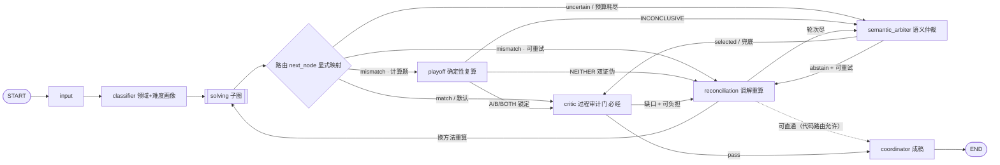
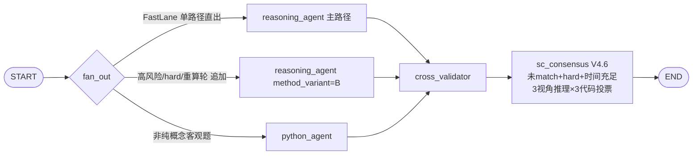

# 系统架构总览（当前版）

> 本文档与代码一一对应。渲染图见 [architecture.png](architecture.png)（生成脚本
> `docs/gen_architecture_diagram.py`，离线可重复生成，带文本重叠 QA 自检）。
> 代码事实来源：`user_agent.py` / `langgraph_math_agent.py` / `graph/solving_subgraph.py`
> / `nodes/*` / `utils/*` / `config.py`。

## 一、五层总览

```
┌─────────────────────────────────────────────────────────────┐
│ ① 竞赛评测平台（官方）  并发3 · 单题20min · 全卷6h · 112题      │
│    Judger = Intern-S 语义判分（LaTeX 等价判对）                 │
└──────────────────────────────┬──────────────────────────────┘
                               │ from user_agent import ReasoningAgent
                               │ agent.solve(problem, metadata)
┌──────────────────────────────┴──────────────────────────────┐
│ ② 入口层 user_agent.py — ReasoningAgent（平台唯一入口）        │
│    sys.path 自举 / 导入守卫 / solve 全兼容签名 / client 探测调优 │
│    双后端：graph 主用 ←→ fallback 直调（核心导入失败保底）       │
└──────────────────────────────┬──────────────────────────────┘
                               │ create_initial_state → MathAgentGraph.run()
                               │ Deps(client, skills, mcp, 预算)
┌──────────────────────────────┴──────────────────────────────┐
│ ③ 编排层 LangGraph 主图（langgraph_math_agent.py）             │
│    input → classifier → solving▢ → 路由 → playoff /            │
│    reconciliation / semantic_arbiter → critic 审计门 →        │
│    coordinator → END（详见下方 Mermaid）                       │
├─────────────────────────────────────────────────────────────┤
│ ④ 支撑基础设施（Deps 注入 · config.py 统一开关）                │
│    LLM 通道 / 预算引擎 / 确定性工具包 / 执行器与知识             │
├─────────────────────────────────────────────────────────────┤
│ ⑤ 本地工具链 local_test/ · tests/（离线 · 不入评测仓库）         │
└─────────────────────────────────────────────────────────────┘
```

## 二、主图拓扑（与 `langgraph_math_agent.py` 一致）



路由函数事实（代码级）：

| 路由 | 判定 | 去向 |
|---|---|---|
| `route_after_solving` | `should_terminate` | critic |
| | `next_node = playoff` | playoff |
| | `next_node ∈ {reconciliation, semantic_arbiter}` | 对应节点 |
| | 其余（match/默认） | **critic（必经审计门）** |
| `route_after_reconciliation` | `next_node ∈ {solving, semantic_arbiter, coordinator}` | 对应节点 |
| | 其余（fallback） | coordinator（**可绕过 critic 直通**） |
| `route_after_semantic_arbiter` | `next_node = reconciliation` | reconciliation |
| | 其余 | critic |
| `route_after_playoff` | `next_node ∈ {critic, reconciliation, semantic_arbiter}` | 对应节点 |
| | 其余 | semantic_arbiter |
| `route_after_critic` | `next_node = reconciliation` | reconciliation |
| | 其余 | coordinator |

## 三、solving 子图（多径扇出，与 `graph/solving_subgraph.py` 一致）



扇出纪律：首轮仅高风险四领域（离散数学、非基础及进阶课程、微分几何、测度积分）双路；
**hard 一律双路**（仅受剩余硬时间 >400s 约束）；重算轮一律追加；FastLane（L1 客观题
高置信）单路；纯概念客观题跳过 Python。

`sc_consensus`（V4.6，V5.3 配置化触发门）：validation 未 match + 计算类 + 每题一次 +
`remaining_hard ≥ sc_trigger_remaining_s[difficulty]`（easy/medium 600s、hard 700s）触发；
任通道 ≥2 一致即锁定，全不一致走原链路不更差；800s 封顶。V5.3：`second_python_done`
（双验证失败未锁定）不再整体跳过 SC——采样投票保留，仅跳过 SC 内程序化验证器阶段；
`cross_validator` 节点超时 30s→460s（解锁 200-450s 的第二代码检查）。

## 四、支撑基础设施（第四层分组）

| 分组 | 组件 | 职责 |
|---|---|---|
| LLM 通道 | `llm_client` / `llm_retry` / `prefill` / `response_normalize` / `cot_stripper` | 全部调用走 `chat_with_retry` / `chat_prefilled`（deadline 计价）；prefill 抑制 CoT（单次 811s→41-77s）；`thinking_mode=False` 关深度思考；截断续写 ≤2 轮；限流退避；响应全形态归一 |
| 预算引擎 | `time_budget` / `paper_pacer` / `token_budget` / `confidence_gate` / `retry_affordability` | 难度软预算 480/840/1200s；硬限 1200s + 300s reserve 保底；PaperPacer 全卷 6h 完成率；Token 分级 8192/12288/16384；置信三档 fast/standard/deep |
| 确定性工具包 | `sympy_pre_solver` / `answer_matcher` / `modular_guard` / `judge_confirm` / `counting_guard` / `numeric_crosscheck` / `form_align` / `semantic_judge` | sympy 事前短路；限时代简·符号对齐等价判定；模结构三重守护；判断题双向确认；计数枚举对照；数值比对兜底；形式对齐；确定性判分器（本地判分对齐） |
| 执行与知识 | `mcp_servers/python_executor` / `skills_loader` / `prompt_templates` / `state` / `error_handler` / `answer_cleanliness` | 沙箱执行（静态安全扫描 + RLIMIT + 60s）；18 领域手册检索；集中提示词；状态模型（`NotRequired` + reducer）；node_wrapper 超时/降级；洁净度门 |

## 五、关键设计事实（与 README 的差异点）

1. **Critic 审计门**：`cross_validator` 默认 `next_node=coordinator`，但 `route_after_solving`
   将其强制改判为 critic——"必经审计门"由主图路由强制，不是提示词自觉。
2. **reconciliation 可直通 coordinator**：`route_after_reconciliation` 的 fallback 分支
   直接返回 coordinator（绕过 critic）。图中以虚线标注；critic 缺口清单在成稿提示中的
   显性补齐仍覆盖该路径。
3. **Playoff 只进一次**：`playoff_trace` 防循环；证明/概念题返回 INCONCLUSIVE 退回仲裁。
4. **软预算只减可选阶段购买力**：`remaining_hard`（1200s 平台硬限）永不下调，进行中的
   调用不被截断，reserve 配额通道（压缩重试/仲裁/应急直答）照常可用。

## 六、本地工具链（第五层，不入评测仓库）

`main.py`（批量求解，asyncio 并发默认 8）· `local_test/run_tests.py`（断点续跑）·
`local_test/grade_llm.py`（LLM 判分 + `semantic_judge` 确定性交叉复核，防判分误杀）·
`local_test/server.py`（监控面板）· `tests/`（206 项离线回归，零 API）·
官方双槽 A/B 实验脚本（main 冻结 + feature 分支对比）。

---

*渲染图生成：`python docs/gen_architecture_diagram.py` → `docs/architecture.png`*
